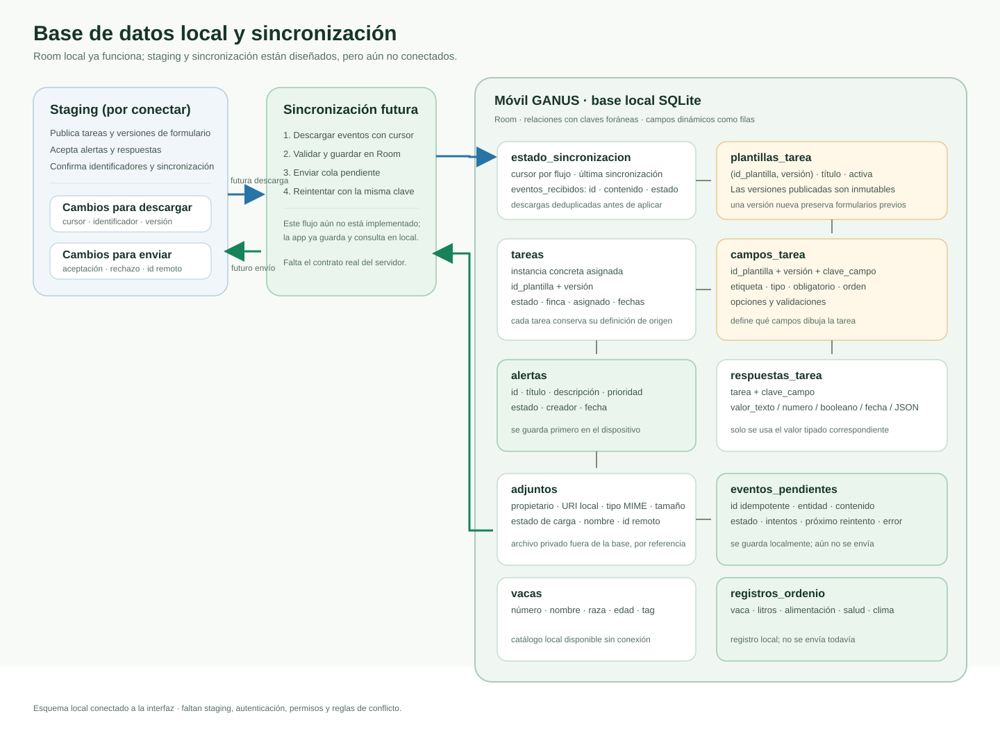

# Base de datos local y conexión futura con staging

## Estado actual

La aplicación incluye una base local SQLite administrada con Room. `BaseDatosGanus` contiene once tablas y `ModuloBaseDatos` la registra en Hilt. La base se crea como `ganus_local.db`; la migración de la versión 1 a la 2 conserva los datos y agrega vacas y registros de ordeño.

La interfaz de demostración está conectada a Room para operar offline: vacas, tareas, respuestas, alertas, metadatos de evidencias y registros de ordeño se leen o guardan localmente. Al iniciar, la lista de tareas carga tres tareas de ejemplo con plantillas dinámicas de inspección de vacas (6 campos), actividad de finca (8 campos) y mantenimiento de equipo (7 campos). El formulario se construye con los campos y su orden guardados en Room; no requiere una columna por campo y valida obligatoriedad y tipos antes de completar. La pantalla Historial muestra tareas completadas, ordeños y alertas creadas ordenados por fecha y hora; las alertas se resaltan en rojo, y al tocar una tarea se abre su detalle con respuestas y evidencias en miniatura, que se pueden abrir. La pantalla Cuenta muestra el usuario actual, su rol de operador y la acción para cerrar la vista previa y volver al acceso. Al adjuntar evidencia se puede elegir un archivo compatible desde el selector del sistema. Las escrituras que deberán sincronizarse se agregan en la misma transacción a `eventos_pendientes`. **No hay conexión activa con staging ni se realizan solicitudes de sincronización**; el contrato propuesto está en [contrato-staging-formularios.md](./contrato-staging-formularios.md).

## Firma para distribución Android

Las compilaciones `debug` se firman con el certificado de depuración local y no son adecuadas como firma de distribución. El tipo `release` acepta un almacén y contraseñas por variables de entorno (`GANUS_RELEASE_STORE_FILE`, `GANUS_RELEASE_STORE_PASSWORD`, `GANUS_RELEASE_KEY_ALIAS`, `GANUS_RELEASE_KEY_PASSWORD`); no se deben incluir las claves privadas en Git. La firma permite identificar al editor y actualizar la aplicación con la misma identidad, pero no puede eliminar por sí sola los avisos de Google Play Protect al instalar APKs por fuera de una tienda. Para distribuir a usuarios y obtener verificación/reputación, publica la app en Google Play usando Play App Signing. El flujo de acceso de esta vista previa tampoco es autenticación real todavía.

## Diagrama

## Tablas implementadas

| Tabla local | Uso |
|---|---|
| `estado_sincronizacion` | Guarda el cursor y la última sincronización correcta de cada flujo. |
| `eventos_recibidos` | Conserva eventos descargados antes de aplicarlos; el identificador de evento evita procesar duplicados. |
| `plantillas_tarea` | Guarda las versiones publicadas de cada formulario; `(identificador_plantilla, version)` identifica cada versión. |
| `campos_tarea` | Define los campos de cada versión: clave, etiqueta, tipo, obligatoriedad, orden, opciones y validaciones. |
| `tareas` | Guarda cada tarea asignada y su estado, vinculada a la versión exacta de su plantilla. |
| `respuestas_tarea` | Guarda la respuesta de cada tarea/campo en una columna tipada, sin crear columnas nuevas por formulario. |
| `alertas` | Guarda título, descripción, prioridad, estado, fechas y los identificadores local y remoto de cada alerta. |
| `adjuntos` | Guarda metadatos y URI local de una foto o video asociado a una alerta, tarea u ordeño; el archivo no se guarda dentro de SQLite. |
| `eventos_pendientes` | Mantiene los eventos locales que esperan envío o reintento al servidor. |
| `vacas` | Mantiene el catálogo local de animales disponible sin conexión. |
| `registros_ordenio` | Conserva litros y datos relacionados con cada ordeño, asociados a una vaca. |

Las clases, propiedades públicas, funciones DAO y nombres de tabla están en español. Los valores de estado son constantes de dominio almacenadas como texto, por ejemplo `ABIERTA`, `PENDIENTE`, `EN_CURSO`, `COMPLETADA`, `SINCRONIZADA` y `FALLIDA`; antes de recibir datos del servidor, se debe acordar el vocabulario definitivo.

## Tareas con campos dinámicos

Los campos de un formulario son filas de `campos_tarea`, no columnas nuevas de una tabla. Si staging publica una tarea con campos distintos, se almacena una nueva versión de `plantillas_tarea` y sus correspondientes filas de `campos_tarea`.

Por ejemplo, la versión 1 puede incluir `temperatura` (número), `apetito` (opción) y `observaciones` (texto). La versión 2 puede añadir `foto`. Una tarea ya asignada sigue vinculada a la versión 1; las tareas nuevas pueden usar la versión 2. Esto evita reinterpretar respuestas existentes.

`respuestas_tarea` admite texto, número, booleano, fecha y JSON. El formulario dinámico valida el tipo, la obligatoriedad, opciones y rangos numéricos disponibles, y el repositorio comprueba que cada clave de respuesta pertenezca a la versión de plantilla asignada a esa tarea.

## Cómo conectarla a staging

### 1. Definir el contrato del servidor

Solicita al equipo de backend:

- URL HTTPS distinta para desarrollo, pruebas y producción.
- Forma de autenticación y renovación de credenciales.
- Endpoint o mecanismo para bajar cambios por cursor, incluyendo identificador único de evento, cursor siguiente, versión del esquema y payload.
- Estructura de publicación para plantillas, campos y tareas asignadas.
- Endpoint para subir alertas, respuestas y cambios de estado.
- Formato de confirmación con el identificador remoto, rechazos y errores que se pueden reintentar.
- Proceso de carga de archivos, límites, tipos MIME y confirmación de la evidencia.
- Reglas de conflicto, borrado y permisos.

No se deben adivinar rutas ni nombres de propiedades del API: deben coincidir con el contrato real del staging.

### 2. Crear modelos de transporte separados

Define DTOs Kotlin serializables para los mensajes de la API. Convierte cada DTO a las entidades Room correspondientes dentro de un repositorio. Mantener separados DTO y entidad evita que un cambio en el JSON del backend cambie por accidente el almacenamiento local.

### 3. Implementar la descarga con transacciones

Un futuro servicio de sincronización leerá el cursor con `EstadoSincronizacionDao`, descargará eventos mediante Retrofit y, por cada lote, usará `BaseDatosGanus.withTransaction` para:

1. Insertar el evento mediante `EventosRecibidosDao.insertarSiEsNuevo`.
2. Si ya existía, no volver a aplicarlo.
3. Validar versión y tipos; guardar plantilla, campos y tareas en el orden requerido.
4. Marcar el evento aplicado y avanzar `estado_sincronizacion` únicamente dentro de la misma transacción.

Si la transacción falla, se revierte tanto la aplicación de datos como el avance del cursor, para que el lote pueda intentarse otra vez.

### 4. Guardar primero en el teléfono y luego enviar

`RepositorioLocalGanus` guarda alertas, respuestas/estado de tareas y registros de ordeño junto con su evento en `eventos_pendientes`, dentro de una transacción Room. La interfaz observa los datos locales y no espera al servidor. La cola solo documenta lo pendiente; todavía no hay un trabajador que la envíe.

Un `WorkManager` puede buscar eventos vencidos con `EventosPendientesDao.obtenerParaEnviar`, enviarlos con Retrofit y marcar solo los confirmados. Cada evento debe llevar un UUID estable como clave de idempotencia: después de un timeout se reenvía la misma clave para evitar duplicados. Los errores transitorios se reintentan con espera creciente; un rechazo definitivo queda visible para su resolución.

El interceptor actual reintenta solo operaciones seguras de lectura (`GET`, `HEAD`, `OPTIONS`). Las escrituras (`POST`, `PUT`, etc.) no deben reintentarse automáticamente sin idempotencia definida por el servidor.

### 5. Subir evidencias

Los archivos se conservan en almacenamiento privado y `adjuntos.uri_local` apunta al archivo. El trabajador de sincronización los sube según el contrato del servidor y después agrega el identificador remoto a la operación que los referencia. No se debe convertir una URI local en una URL pública.

## Piezas disponibles en el proyecto

- Base y configuración Room: `core/local/BaseDatosGanus.kt` y `core/local/ModuloBaseDatos.kt`.
- Entidades/tablas: `core/local/EntidadesLocales.kt`.
- Consultas DAO: `core/local/AccesoDatosLocales.kt`.
- Repositorio offline-first de la interfaz: `core/local/RepositorioLocalGanus.kt`.
- Cliente HTTP Retrofit y token: `core/di/NetworkModule.kt` y `core/network/AccessTokenProvider.kt`.

Las tareas y vacas visibles al abrir la vista previa se insertan como datos de demostración de manera idempotente. Las tareas conservan respuestas tipadas por campo; el contenido de formularios futuros deberá representarse en `campos_tarea` y consumirse mediante un formulario dinámico. El responsable de una tarea se muestra como el usuario actual recibido desde el acceso y no se puede editar en el formulario. En la vista previa, que todavía no autentica, se usa el correo válido ingresado en la pantalla de acceso como identificador; si no se ingresó uno, se muestra "Usuario de demostración". El formulario de alertas, las observaciones de tareas y las observaciones del ordeño permiten elegir fotos o videos de la galería, o tomar una foto con la cámara. Las fotos capturadas se guardan en el almacenamiento privado de la app; el selector conserva los permisos persistibles de las URI externas. Desde el detalle de tarea, el historial y las alertas se puede abrir la evidencia con una aplicación compatible del dispositivo.

## Pendiente antes de una integración real

El staging debe entregar su URL y contrato, autenticación, ejemplos reales de eventos, política de conflictos y servicio de archivos. La aplicación ya persiste localmente, pero no descarga tareas del staging ni envía alertas, respuestas, ordeños o archivos. Antes de publicar cambios que alteren tablas se deben incluir migraciones Room.
